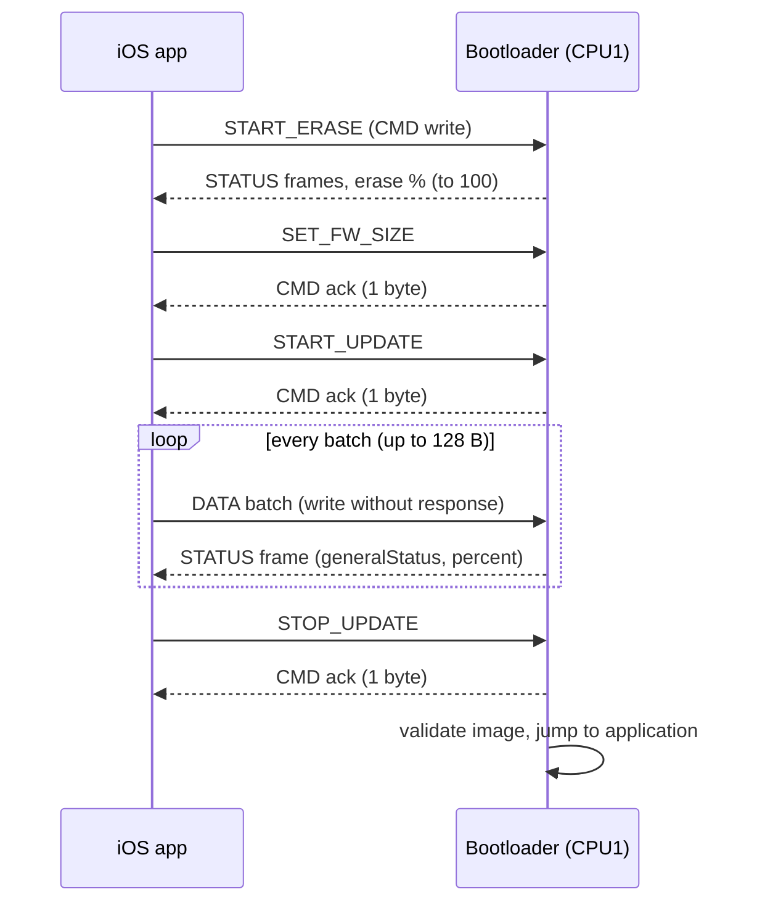

# STM32WB55 OTA DFU

This project implements a BLE-based firmware update bootloader for the STM32WB55 MCU. It runs in the bootloader region, owns the application flash area, and receives upgrade commands from a remote host (for example a mobile app or desktop tool) over a custom BLE service.

The design separates the OTA protocol layer, the firmware-update state machine, and the low-level flash programming logic so the bootloader can validate commands, write firmware chunks safely, and then hand control to the user application.

## How it works
 

 
Two kinds of acknowledgement are used, and the host must not mix them up:
 
- **Commands** are acknowledged with **one byte on a CMD notification** (`0x00` = OK, anything else = failure).
- **Data batches** are acknowledged with a **4-byte STATUS frame**.
During erase, the bootloader streams 4-byte STATUS frames carrying the erase percentage.
 
---

## 1. High-level architecture

The project is organized around four main layers:

- BLE service layer
  - Generated/custom STM32 WPAN service code under `STM32_WPAN/App/`
  - Handles connection events and characteristic notifications
  - Forwards received payloads to the OTA parser

- Protocol layer
  - `App/AppComm.c` and `App/AppComm.h`
  - Validates frame format, CRC, and command length
  - Converts incoming BLE payloads into bootloader commands

- Control/state machine
  - `App/App.c` and `App/App.h`
  - Implements the bootloader lifecycle and flash-update workflow
  - Switches between waiting, idle, erase, update, and jump-to-application states

- Flash management
  - `Common/BootloaderConfig.h`
  - `App/App.c`
  - Writes firmware data into the application region and validates the final image before jumping

## 2. Memory and flash layout

The bootloader reserves a dedicated region at the start of flash, then uses the remaining space for the application image.

- `BOOTLOADER_SIZE`: 0x10000
- `APP_FLASH_START`: `FLASH_BASE + BOOTLOADER_SIZE`
- `APP_FLASH_SIZE`: 480 KiB
- `FLASH_WRITE_CHUNK`: 8 bytes

This lets the bootloader keep a stable execution area while programming a new firmware image into the application region.

## 3. Communication flow

### 3.1 BLE connection and notification path

1. The firmware starts in `main()`.
2. MCU and BLE stack initialization are performed with `MX_APPE_Init()` and `MX_APPE_Process()`.
3. BLE events are handled by `Custom_STM_App_Notification()` in `STM32_WPAN/App/custom_app.c`.
4. Two events are especially important:
   - `CUSTOM_STM_CMD_WRITE_EVT` for command frames
   - `CUSTOM_STM_DATA_WRITE_NO_RESP_EVT` for firmware batch writes

### 3.2 Command frame format

The bootloader uses a compact binary protocol defined in `App/AppComm.h`.

The command frame layout is:

- `SOF`: 1 byte, fixed value `0xAA`
- `command`: 1 byte
- `length`: 1 byte
- `data`: variable sized payload
- `CRC`: 1 byte (CRC-8 over the preceding bytes)

The supported commands are:

- `COMMAND_START_ERASE`
- `COMMAND_START_UPDATE`
- `COMMAND_STOP_UPDATE`
- `COMMAND_GET_STATUS`
- `COMMAND_SET_FW_SIZE`
- `COMMAND_SET_FW_HASH`

The bootloader validates:

- correct start-of-frame byte
- length within allowed limits
- exact frame size matching the declared length
- CRC correctness

If validation passes, the frame is decoded and processed; otherwise it is ignored.

### 3.3 Firmware batch flow


Firmware data is not sent as a large command frame. Instead, it is transmitted as data batches over a no-response characteristic:

- payload begins with a 32-bit offset
- followed by a size byte
- followed by the actual chunk data
- terminated by a CRC byte

`AppComm_ParseDataBanchMessage()` verifies the chunk size and CRC, then calls `App_FlashWriteBantch()` to place the data into the flash programming pipeline.

### 3.4 Status reporting

Status is reported back using the `CUSTOM_STM_STATUS` characteristic:

- `AppComm_SendUpdateStatus()` sends the current flash-write progress
- `AppComm_SendEraseStatus()` sends the erase progress
- `AppComm_CommandResponse()` sends command acknowledgements

These packets wrap the payload with the protocol SOF and CRC so the host can verify the response.

## 4. Control flow

### 4.1 Main loop and lifecycle

The application lifecycle is driven by the `AppState` enum in `App/App.h`.

State transitions:

- `APP_INIT`
- `APP_WAITING_FOR_CONNECTION`
- `APP_IDLE`
- `APP_START_UPDATE`
- `APP_ERASE_FLASH`
- `APP_UPDATING`
- `APP_END_UPDATE`
- `APP_ERROR`

The main loop in `main()` does two things continuously:

1. `MX_APPE_Process()`
   - maintains the BLE stack and handles BLE events
2. `App_Run()`
   - dispatches the current application state handler

The dispatcher is a simple table indexed by state, as shown in `App_Run()`.

### 4.2 Connection state

When the BLE connection is established:

- `Custom_APP_Notification()` receives `CUSTOM_CONN_HANDLE_EVT`
- `App_DeviceConnected()` sets the state to `APP_IDLE`
- the LED is switched on

When the connection is lost:

- `CUSTOM_DISCON_HANDLE_EVT` is handled
- `App_DeviceDisconnected()` returns the state to `APP_WAITING_FOR_CONNECTION`
- the LED enters a fast blink pattern

### 4.3 Command processing flow

When a command is received:

1. `Custom_STM_App_Notification()` calls `AppComm_ParseCommandMessage()`
2. `AppComm_ParseCommandMessage()` checks the frame and extracts the command
3. `AppComm_ProcessCommand()` dispatches on the command ID
4. The selected state is updated via `App_SetState()`
5. A command response byte is sent back to the host

Examples:

- `COMMAND_START_ERASE` -> `App_SetState(APP_ERASE_FLASH)`
- `COMMAND_START_UPDATE` -> `App_SetState(APP_START_UPDATE)`
- `COMMAND_STOP_UPDATE` -> `App_SetState(APP_END_UPDATE)`
- `COMMAND_SET_FW_SIZE` -> stores the target firmware size in `app.fwInfo.size`
- `COMMAND_SET_FW_HASH` -> stores the firmware hash split across 2 parts

### 4.4 Update sequence

The firmware update operation follows this sequence:

1. Host sends `SET_FW_SIZE` and `SET_FW_HASH`
2. Host sends `START_UPDATE`
3. Bootloader enters `APP_START_UPDATE`
4. Internal update fields are reset and `APP_UPDATING` is entered
5. Host sends data batches with offsets and chunks
6. Each chunk is written into the application region via `AppProcessWritingPages()`
7. Progress is reported periodically as percentage complete
8. Host sends `STOP_UPDATE`
9. Bootloader validates the image by checking the reset vector and stack pointer at `APP_FLASH_START`
10. If valid, it jumps to the application via `App_JumpToApplication()`

### 4.5 Erase sequence

Erase is triggered by `COMMAND_START_ERASE`.

During erase:

- `App_SetState(APP_ERASE_FLASH)` initializes erase parameters
- `App_ProcessEraseFlash()` walks page-by-page over the application area
- each page is erased using the STM32 flash controller
- progress is reported as a percentage to the host

At the end of erase, the state returns to `APP_IDLE` or `APP_ERROR`, depending on the result.

### 4.6 Validation and jump-to-application

Before final handoff, `App_EndUpdate()` calls `App_ImageCheck()` to validate the image headers placed at the start of the application flash region.

This checks:

- stack pointer is valid and within SRAM range
- reset handler address is valid inside the app flash region
- pointer alignment and other required characteristics

If validation succeeds, the bootloader resets the system state, relocates the vector table, and jumps to the application entry point.

## 5. Key execution points

Relevant files:

- `Core/Src/main.c` – system startup and main loop
- `App/App.c` – bootloader state machine and flash programming
- `App/AppComm.c` – BLE command/data parsing and response generation
- `STM32_WPAN/App/custom_app.c` – BLE event routing
- `Common/BootloaderConfig.h` – flash layout and timings

## 6. Typical OTA update workflow

A typical OTA session looks like this:

```text
Host -> BLE CMD: SET_FW_SIZE
Host -> BLE CMD: SET_FW_HASH
Host -> BLE CMD: START_UPDATE
Host -> BLE DATA: firmware chunk #1
Host -> BLE DATA: firmware chunk #2
Host -> BLE DATA: firmware chunk #N
Host -> BLE CMD: STOP_UPDATE
Bootloader -> BLE STATUS: progress / completion
Bootloader -> BLE CMD: ACK / OK
Bootloader validates new image and jumps to application
```

This gives a clear separation between command transport, firmware payload transfer, state control, and final image activation.

## 7. Summary

The bootloader is a layered OTA controller:

- BLE receives the command and data stream
- `AppComm` validates and decodes the protocol
- `App` manages the lifecycle and verifies safety conditions
- the flash controller writes the new image into the application section
- the bootloader hands execution over to the valid application image when the operation is complete

This keeps firmware updates reliable, observable, and easy to integrate with external tooling.

## Example updater application

See the [STM32WB55 DFU iOS Updater](https://github.com/MaxymSmal37/STM32WB55_DFU_IOS_Updater) for an example application to test firmware updates.
